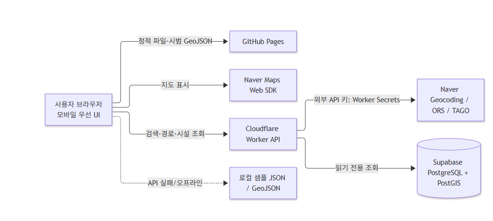

# 턱없이 기술 요구사항 정의서 (TRD)

- 기준 문서: `턱없이_해커톤_PRD_최종본`
- 문서 목적: 해커톤 시제품의 기술 선택, 데이터 경계, 구현 순서를 명확히 한다.
- 설계 원칙: 마산 시범 구역에 집중하고, 외부 연동 실패에도 시연이 가능해야 하며, 미검증 정보를 안전한 경로로 오인시키지 않는다.
- 상태 기준: 2026-11-26, `main`의 현재 작업본 및 `tests/prototype.test.cjs` 기준. 실행된 단위 테스트와 계획만 있는 API/실사용자 검증을 구분하며, 미연동 기능을 완료한 것으로 표시하지 않는다.

### 현재 시안과 목표의 차이

| 항목 | 현재 저장소에서 확인된 내용 | 목표 및 미완료 사항 |
|---|---|---|
| 화면·배포 | `index.html` 단일 파일에 마산 시범 프리셋 3개, SVG 경로, 정적 버스·충전소 목록, 배터리 계산과 도움 요청이 있다. 샘플 고지를 추가했다. `.github/workflows/pages.yml`은 Pages 배포를 정의한다. | 실지도·장소 검색·실제 경로 연동은 미구현. 실제 Pages 배포 성공 여부는 확인하지 않았다. |
| 경로 | 프리셋 SVG 경로와 위험 마커가 겹치는 빠른 경로는 선택과 지도 표시를 막고, 임의 장소 검색은 완료로 가장하지 않는다. 충돌 계산은 도식의 SVG 픽셀만 사용한다. | 실제 입력 좌표와 GeoJSON 기반의 미터 단위 장애물 대조·우회 재탐색은 미구현. 현장 안전이나 통행 가능성의 검증 근거가 아니다. |
| 버스·위치·도움 | 버스는 고정 시연 데이터임을 표시한다. GPS 버튼은 브라우저 권한을 요청해 실좌표만 표시하며, 주소 변환·위치 전송은 하지 않는다. 위치 복사는 좌표 확인 후 명시적 버튼으로만 수행한다. 119·누비콜 버튼은 사용자 동작으로 전화 앱을 열고 보호자 문자는 초안 복사만 제공한다. | TAGO 실시간 조회, 도로명 주소 역지오코딩, 문자 자동 전송·위치 공유는 미연동이다. |
| 배터리 | 잔량 0%를 허용하고 잘못된 빈 값·범위 초과 및 완충 거리 0을 오류로 표시한다. 추정치는 안전·도달 보장이 아님을 고지한다. | 수치의 실제 주행 예측 정확도는 검증되지 않았다. |

위 차이는 구현할 작업이지 이미 해결되었다는 뜻이 아니다. 실제 마산 경로·현장 장애물·공공시설 정보는 아직 대조하지 않았다.

## 1. 시스템 아키텍처

### 1.1 권장 기술 스택

| 영역 | 권장 기술 | 선택 이유 및 제약 |
|---|---|---|
| 웹 클라이언트 | HTML, CSS, Vanilla JavaScript ES modules | 현재 시안이 단일 `index.html`이며, 별도 프레임워크나 빌드 단계 없이 가장 빠르게 기능을 분리할 수 있다. |
| 정적 호스팅 | GitHub Pages + 현재 GitHub Actions 배포 | 저장소에 이미 배포 workflow가 있다. 정적 프런트엔드와 샘플 데이터는 무료로 바로 배포한다. Pages 게시 사이트는 최대 1 GB, 월 100 GB 대역폭은 권장 한도(soft limit)다. |
| API / 비밀키 보호 | Cloudflare Workers Free | Naver·OpenRouteService·공공 API의 비밀 키를 브라우저에 넣지 않고, 외부 API 응답을 정규화·캐시하는 작은 서버리스 API로 사용한다. 무료 플랜 한도는 현재 문서 기준 요청 100,000회/일이며 변경될 수 있다. |
| 데이터베이스 | Supabase PostgreSQL Free + PostGIS | 장애물 선분·충전소·정류장처럼 위치와 관계가 있는 데이터를 SQL로 관리하고, PostGIS로 공간 조회를 확장할 수 있다. 무료 DB 용량은 프로젝트당 500 MB이며, 1주 비활성 프로젝트는 일시 중지될 수 있으므로 시연/초기 검증용으로 한정한다. |
| 지도 / 경로 | Naver Maps Web Dynamic Map, OpenRouteService, OSM | PRD의 정보 제공처를 따른다. 실시간·커버리지·호출량은 제공자 조건에 종속되며, 접근성 속성은 별도 현장 검증 데이터와 함께 판단한다. |
| 버스 | 국토교통부 TAGO 및 창원시 버스정보 | 실시간 연동은 별도 단계로 두고, 연동 전에는 시범 데이터임을 표시한다. |

**비용·가용성 전제:** 현재 저장소의 GitHub Pages는 정적 시안 배포에 가장 빠른 선택이다. 실제 API 키가 필요한 기능을 추가할 때만 Worker를 붙이고, 공간 데이터가 수작업 샘플을 넘어설 때 Supabase를 연결한다. 무료 플랜은 SLA나 긴급 이동 안전을 보장하지 않는다. 서비스가 실제 이동의 유일한 안전 판단 수단이 되지 않도록 한다.

### 1.2 구성도 및 요청 흐름



1. 사용자가 위치 사용을 허용하거나 마산 내 장소를 검색해 출발지·도착지를 입력한다. 브라우저는 경로 요청에 필요한 최소 좌표와 기기 유형만 Worker에 보낸다.
2. Worker는 외부 경로·장소 API를 호출하고, DB의 검증된 접근성 구간과 대조해 쉬운 길·빠른 길 후보를 정규화한다.
3. 클라이언트는 `live`, `curated`, `sample`, `unknown`과 마지막 갱신 시각을 함께 표시한다. API 실패 시 로컬 샘플로 전환하되 샘플 데이터임을 화면에 명시한다.
4. 배터리 계산은 브라우저에서 수행한다. 방전 도움 화면은 사용자가 확인 후 전화·문자 앱을 여는 시연 흐름만 제공하며 자동 발송하지 않는다.

### 1.3 경로 판정 및 오류 처리

- PRD 시제품 기준을 정책 설정으로 분리한다: 유효 보도폭 1.2 m 미만, 장애물 간격 0.8 m 미만, 단차 2 cm 초과, 계단, 경사 1/12(약 4.8°) 이상. 이는 초기 분류 기준이지 모든 이동기기의 법적·기술적 통과 보증이 아니다.
- 현장에서 확인된 진입 불가 구간은 후보 경로에서 제외하고 빨간색·사유와 함께 표시한다. 기준값에 걸리지만 기기별 통과 여부가 검증되지 않은 구간은 주황색 주의로 표시한다. 정보가 없는 구간은 회색 `미확인`으로 남기며 초록색 안전 경로로 단정하지 않는다.
- 우회 경로가 없거나 경로와 접근성 자료를 신뢰성 있게 대조할 수 없으면 “경로 확인 불가”를 반환한다. 출처 API가 반환한 경로만으로 안전을 보증하지 않는다.
- 외부 API 오류, 타임아웃, 빈 응답은 출처별 오류로 기록하고 샘플 데이터로 전환한다. 샘플 데이터도 없으면 오류 상태를 사용자에게 알리며 빈 성공 응답으로 처리하지 않는다.
- 지도 렌더링용 Naver 클라이언트 키는 허용 도메인 제한을 설정한다. 외부 API 비밀 키는 Worker 환경의 Secret으로만 저장하며 GitHub 저장소·브라우저 번들·로그에 기록하지 않는다.

### 1.4 API 경계

Worker API는 공급자별 응답을 서비스 내부 형식으로 정규화한다.

| 메서드 / 경로 | 목적 | 주요 입력·출력 |
|---|---|---|
| `GET /api/v1/places/search?q=` | 마산 장소 검색 | 검색어, 장소 이름·좌표·출처 |
| `POST /api/v1/routes/compare` | 쉬운 길·빠른 길 비교 | 출발지·도착지 좌표, 기기 유형; 경로 선형, 거리·시간, 접근성 구간, 데이터 상태 |
| `GET /api/v1/chargers?bbox=` | 충전소 조회 | 지도 범위; 위치·운영 정보·출처·갱신 시각 |
| `GET /api/v1/bus/stops?near=` | 정류장·저상버스 정보 조회 | 기준 좌표; 정류장·운행 정보·실시간/샘플 상태 |

요청 좌표는 마산 시범 구역 범위를 우선 검증한다. Provider 응답의 공급자 전용 필드가 UI에 전파되지 않도록 변환 계층을 둔다. 실제 TAGO 도착정보·저상버스 유형 연동은 API 키와 데이터 제공 범위를 확인한 뒤 활성화한다.

### 1.5 외부 연동·무료 이용 체크리스트

아래는 공식 문서로 확인한 연결 방법과 **실제 계정·지역 호출로 확인해야 할 항목**이다. 예산을 0원으로 유지하려면 가입 전 결제수단 필요 여부, 한도 초과 과금·차단 방법과 이용약관을 각 콘솔에서 확인한다. 별도 신용카드 등록이나 유료 플랜 활성화는 승인 없이 하지 않는다.

| 구성요소 | 연결 절차와 실제 확인 항목 | 상태 |
|---|---|---|
| GitHub Pages | `main`의 Pages Actions 실행 완료와 실제 URL 접속을 확인한다. 저장소에는 workflow가 있으나 실행 성공은 별도 확인이 필요하다. | 설정 파일 확인, 배포 실행 미확인 |
| Naver Maps Web SDK | Naver Cloud 콘솔에서 Maps Application을 등록하고 Web Dynamic Map 사용 및 실제 Pages 도메인/경로의 허용 설정을 확인한다. 브라우저용 Client ID만 공개한다. | 키 발급·실지도 미확인 |
| Naver Geocoding | Application에서 Geocoding을 선택하고 서버 호출의 Client ID와 Client Secret을 Worker Secret으로 저장한다. 공식 문서는 `x-ncp-apigw-api-key-id`, `x-ncp-apigw-api-key` 인증 헤더를 명시한다. Geocoding은 주소 변환이므로 상호명·장소 검색이 가능한 별도 서비스는 범위와 이용조건을 확인해야 한다. | 인증·마산 주소 응답 미확인 |
| OpenRouteService | 계정을 만들고 API 키를 Worker Secret으로 설정한다. `wheelchair` 프로필의 GeoJSON 응답, `avoid_polygons` 지원과 실서비스 크기·요청 제한을 확인한다. OSM 기반으로 마산 보행 데이터와 실제 우회 가능 여부를 확인해야 한다. | 키 발급·실경로·회피 미확인 |
| TAGO | 공공데이터포털에서 버스도착정보 활용 신청 및 인증키를 발급받고 도시코드·정류장 ID를 조회한다. 창원 데이터의 도착·차량 유형·저상 여부가 실제 응답에 존재하는지 확인한다. 없거나 미확인이면 저상 여부를 `unknown`으로 표기한다. | 신청·창원 실시간·저상 여부 미확인 |
| Supabase | 프로젝트 생성 후 PostGIS와 RLS를 설정하고 공개 `SELECT`만 허용한다. DB 키·접근 권한과 무료 프로젝트 일시 중지 정책을 확인한다. 해커톤 초기에는 정적 데이터로 대체 가능하다. | 프로젝트·정책 미확인 |
| Worker 배포 | Worker의 `NAVER_CLIENT_ID`, `NAVER_CLIENT_SECRET`, `ORS_API_KEY`, `TAGO_SERVICE_KEY`를 서버 측 Secret으로 등록한다. 공개 값인 클라이언트 ID를 제외한 비밀값은 Pages·HTML·로그에 넣지 않는다. Pages 출처만 CORS 허용, 타임아웃·쿼터·오류 응답을 확인한다. | 배포·Secrets·CORS 미확인 |

Naver의 공식 가격표에는 Dynamic Map과 Geocoding의 무료 이용량 및 대표 계정 조건이 기재되어 있으나, 계정별 상품 선택·과금과 실제 제공량은 콘솔에서 재확인한다. ORS 공개 서비스의 제한도 신청 당시 확인한다. 인증키가 없거나 호출이 실패하면 실시간 성공이라고 쓰지 않고 샘플 여부를 표시한다.

### 1.6 접근성 경로 판정: 계약·자료·알고리즘

**범위:** 다음 설계는 해커톤용 후보 검증 및 제한적 재탐색이다. 실제 엔진이 모든 보도 접근성을 알고 있거나 전국 경로를 생성한다고 가정하지 않는다. 장애물 없는 최단 경로임을 증명할 수 없고 현장 안전을 보장하지 않는다.

**공통 형식:** 좌표는 GeoJSON/WGS 84 `[경도, 위도]`. ORS `directions`의 `GeoJSON` 결과를 Worker가 `LineString`으로 변환한다. 샘플 `LineString`도 같은 형태를 쓴다. 접근성 구간 역시 `LineString`이며 `source`, `observed_at`, `expires_at`, `status`, `device_scope`를 포함한다. 실데이터는 PostGIS 공간 인덱스로 후보 주변 구간을 검색한다. 아래 좌표는 마산 부근의 **가상 단위 테스트용 좌표**이며 실제 도로·장애물·이동거리를 나타내지 않는다.

```json
{
  "type": "FeatureCollection",
  "features": [
    {
      "type": "Feature",
      "id": "test-blocked-1",
      "geometry": {"type": "LineString", "coordinates": [[128.5800, 35.2380], [128.5800, 35.2390]]},
      "properties": {
        "status": "blocked",
        "reason": "계단",
        "device_scope": ["manual_wc", "electric_wc", "scooter", "stroller"],
        "source": "synthetic_test",
        "observed_at": "2026-11-26T00:00:00Z",
        "expires_at": null
      }
    },
    {
      "type": "Feature",
      "id": "test-caution-1",
      "geometry": {"type": "LineString", "coordinates": [[128.5790, 35.2395], [128.5810, 35.2395]]},
      "properties": {
        "status": "caution",
        "reason": "경사 현장 확인 필요",
        "device_scope": ["manual_wc", "electric_wc", "scooter", "stroller"],
        "source": "synthetic_test",
        "observed_at": "2026-11-26T00:00:00Z",
        "expires_at": null
      }
    }
  ]
}
```

**입출력 예시:** 아래도 구현 예정 계약이다. 후보 경로·장애물 데이터는 가상 샘플이고, `sample`은 실시간 정보를 뜻하지 않는다.

요청 `POST /api/v1/routes/compare`:

```json
{
  "origin": [128.5790, 35.2385],
  "destination": [128.5810, 35.2385],
  "device": "manual_wc",
  "demo_scenario": "synthetic-blocked-crossing"
}
```

```json
{
  "data_status": "sample",
  "generated_at": "2026-11-26T00:00:00Z",
  "blocked_segments": [{"id": "test-blocked-1", "reason": "계단"}],
  "routes": [
    {
      "kind": "easy",
      "geometry": {"type": "LineString", "coordinates": [[128.5790, 35.2385], [128.5790, 35.2395], [128.5810, 35.2395], [128.5810, 35.2385]]},
      "distance_m": null,
      "duration_s": null,
      "access_status": "unknown",
      "caution_segment_ids": ["test-caution-1"]
    }
  ],
  "messages": ["시연용 가상 데이터", "일부 구간의 접근성 미확인"]
}
```

위는 후속 Worker·GeoJSON API를 위한 계약 예시다. 현재 브라우저 시안에는 이 GeoJSON 판정 엔진이 없다. 현 시안의 별도 `routeHasBlockedSegment()`는 도식 SVG 좌표에서 마커와 선분 간 거리를 비교해 진입 불가 마커에 겹치는 **빠른 시범선**만 감춘다. 미터 단위 지리 좌표, GeoJSON, ORS 요청·재탐색을 수행하지 않는다. 이 UI 동작은 실제 도로 안전의 근거가 아니다.

GeoJSON 엔진이 구현되면 빠른 후보 `[128.5790, 35.2385] → [128.5810, 35.2385]`는 `test-blocked-1`과 교차하므로 반환하지 않아야 한다. 우회 후보가 차단선과 교차하지 않더라도 주의 구간과 미확인 데이터가 있으면 `access_status: "unknown"`이어야 한다. 우회 후보가 없으면 `routes: []`, `code: "ROUTE_UNCONFIRMED"` 및 “경로 확인 불가”를 반환한다. `demo_scenario`는 시연 모드에서만 허용하고 실서비스 요청에 사용하지 않는다. 좌표·기기·데이터 버전의 입력값이 샘플과 다르면 임의로 동일 경로를 반환하지 않는다.

**판정 의사코드:**

```text
비어 있거나 유효하지 않은 좌표·기기·시범 범위 → 400과 입력 오류
실연동 모드면 ORS wheelchair 후보 요청; 실패하면 일치하는 시범 샘플을 찾음
시범 모드면 시나리오에 정확히 일치하는 샘플 후보만 사용
해당 샘플이 없으면 ROUTE_UNCONFIRMED + 데이터 출처 표시
각 후보에 대해:
  만료되지 않은 검증 장애물 중 기기에 적용되는 blocked 선분을 조회
  WGS 84 좌표를 미터 단위로 투영하고 후보 선과 장애물 선의 최소 거리 계산
  3m 이내이면 충돌로 판정해 후보에서 제거 (시연용 보수적 허용 오차)
  caution·unknown·누락 또는 만료된 정보는 별도로 표시하고 안전하다고 판정하지 않음
충돌한 실연동 후보가 있으면 차단 선분 주위의 3m 버퍼 Polygon을
  ORS avoid_polygons로 전달해 최대 1회 재탐색하고, 새 후보도 같은 방식으로 재검증
  API가 회피 옵션을 거절하거나 실패하면 결과를 검증된 우회로 간주하지 않음
남은 후보 중 주의 구간이 적은 경로를 쉬운 길, 시간이 짧은 경로를 빠른 길로 표시
  동일 후보만 있으면 한 경로만 반환; 거리·시간이 없는 경우 미확인으로 표시
  한 후보라도 전 구간의 최신 검증 범위를 증명하지 못하면 access_status=unknown
진입 불가 구간을 배제하고 공간 대조를 완료한 후보가 하나도 없으면 ROUTE_UNCONFIRMED
```

3 m는 GPS·자료 정합성 오차를 줄이기 위한 **임시 시제품 가정**이다. 가까운 평행 도로를 잘못 차단하거나 부정확한 장애물을 놓칠 수 있어 현장 비교와 정확도 검증이 필요하다. `ST_DWithin(geography, geography, 3)` 등 미터 단위 공간 연산을 사용하고, 차단 데이터의 공백을 안전하다는 증거로 해석하지 않는다. 과도한 버퍼나 ORS 제한으로 우회가 반환되지 않으면 무조건 경로 확인 불가다. 미확인 구간을 포함한 후보는 **미확인 경로**로만 보여 주며, 실제 이동을 권장하거나 무장애라고 표시하지 않는다.

## 2. 데이터 저장 구조

### 2.1 저장소별 책임

| 저장 위치 | 저장 대상 | 저장하지 않을 대상 |
|---|---|---|
| Git 저장소의 `public/data/demo/` | 검토된 시범 경로, 현장 확인 접근성 구간, 충전소·정류장 샘플. API 장애 시 읽기 전용 폴백으로 사용 | 비밀 키, 실제 사용자 위치 이력, 식별 가능한 사용자 정보 |
| Supabase PostgreSQL/PostGIS | 출처·갱신 시각이 있는 공개·검토 데이터. 초기에는 선택 사항이며 샘플 데이터로 우선 구현 | 개인 프로필, 검색·경로 기록, 배터리 상태 이력, SOS 요청 이력 |
| 브라우저 메모리 | 현재 화면의 출발지·도착지, 사용자가 입력한 배터리 잔량, 현재 세션 결과 | 서버 전송 후 장기 저장 또는 사용자 동의 없는 위치 저장 |
| Cloudflare Worker Secrets | Naver·ORS·TAGO 등 서버 API 비밀 키 | 공개 프런트엔드 설정 파일에 포함되는 비밀 값 |

### 2.2 관계형 공간 데이터 모델

모든 위치는 WGS 84 (`SRID=4326`)를 사용한다. DB 도입 시 PostGIS를 활성화하고, 공개 데이터는 `published = true`인 레코드만 읽을 수 있게 한다.

| 테이블 | 주요 컬럼 | 비고 |
|---|---|---|
| `access_segments` | `id UUID PK`, `geom LINESTRING(4326)`, `status ENUM(blocked,caution,pass,unknown)`, `clear_width_m NUMERIC NULL`, `obstacle_gap_m NUMERIC NULL`, `curb_height_cm NUMERIC NULL`, `slope_ratio NUMERIC NULL`, `has_stairs BOOLEAN`, `device_scope TEXT[]`, `source_id UUID FK`, `observed_at TIMESTAMPTZ`, `expires_at TIMESTAMPTZ NULL`, `published BOOLEAN` | 현장·공공·OSM 자료를 구분하고 측정값이 없으면 `NULL`로 유지한다. `geom`에는 GiST 인덱스를 둔다. |
| `charging_stations` | `id UUID PK`, `name TEXT`, `geom POINT(4326)`, `address TEXT`, `opening_hours TEXT NULL`, `phone TEXT NULL`, `is_active BOOLEAN`, `source_id UUID FK`, `updated_at TIMESTAMPTZ`, `published BOOLEAN` | 운영시간·연락처는 최신성을 보장할 수 없으면 미확인으로 표시한다. |
| `bus_stops` | `id TEXT PK`, `name TEXT`, `geom POINT(4326)`, `address TEXT NULL`, `source_id UUID FK`, `updated_at TIMESTAMPTZ`, `published BOOLEAN` | 정류장 기본 정보와 실시간 도착 정보의 갱신 시각을 분리한다. |
| `data_sources` | `id UUID PK`, `name TEXT`, `uri TEXT`, `license TEXT NULL`, `retrieved_at TIMESTAMPTZ`, `notes TEXT NULL` | 출처·라이선스·수집 시점을 각 시설/구간 데이터와 연결한다. |

**인덱스·무결성:** 공간 컬럼에 GiST, 외부 출처 ID가 있으면 해당 컬럼에 일반 인덱스를 둔다. `status`는 허용 값만 저장하고, 거리·폭·단차는 음수가 될 수 없도록 제약한다. `observed_at` 또는 `updated_at`이 오래된 데이터는 UI에서 갱신 필요/미확인으로 표시한다.

### 2.3 접근 제어, 개인정보, 샘플 폴백

- MVP는 로그인 없이 읽기 전용으로 운영한다. Supabase RLS를 활성화하고 익명 역할에는 게시된 공개 데이터의 `SELECT`만 허용한다. 익명 `INSERT/UPDATE/DELETE`는 금지한다. 데이터 적재·수정은 팀의 신뢰된 수동 배포 절차로 한다.
- 브라우저 좌표는 사용자가 위치 기능을 명시적으로 허용했을 때 현재 요청에만 사용한다. 목적지·현재 위치를 계정이나 DB에 저장하지 않는다. 위치 거부 시 장소 검색과 출발지 직접 입력을 제공한다.
- 배터리 잔량·완충 주행거리·환경계수 입력은 시연 계산에만 사용하고 서버에 보내지 않는다. PRD 계산식 `완충 주행거리 × (잔량 / 100) × 환경계수 × 0.85`와 계수(평지 1.0, 경사 포함 0.8)는 검증되지 않은 가정임을 표시한다.
- 정적 폴백은 `public/data/demo/`에 JSON/GeoJSON으로 버전 관리한다. 각 객체에 `data_status: "sample"`과 `updated_at`을 두고, 폴백 응답도 실시간 데이터처럼 표시하지 않는다.
- 사용자 리뷰 저장·자동 학습, 실시간 BMS 연동, 자동 문자·신고, 전국 경로 엔진은 이번 범위에서 제외한다.

## 3. 파일 구조 및 구현 계획

### 3.1 목표 파일 구조

현재 저장소는 `index.html` 중심 시안과 `.github/workflows/pages.yml` 배포 구성이다. 초기 구현에서는 프레임워크·빌드 단계를 새로 추가하지 않고 ES modules로 점진 분리한다.

```text
.
├── index.html
├── README.md
├── public/
│   ├── manifest.webmanifest
│   ├── icons/
│   └── data/
│       └── demo/
│           ├── routes.geojson
│           ├── access-segments.geojson
│           ├── charging-stations.json
│           └── bus-stops.json
├── src/
│   ├── main.js
│   ├── app/
│   │   ├── state.js
│   │   └── accessibility.js
│   ├── features/
│   │   ├── routes/       # 장소 입력, 경로 비교·표시
│   │   ├── bus/          # 정류장·저상버스 정보
│   │   ├── battery/      # 순수 계산 로직·입력 검증
│   │   └── help/         # 위치 확인·전화/문자 시연
│   ├── services/
│   │   ├── api-client.js
│   │   ├── fallback-data.js
│   │   └── map.js
│   └── styles/
│       └── app.css
├── worker/
│   └── src/
│       ├── index.js
│       └── providers/    # Naver, ORS, TAGO 어댑터
├── supabase/
│   └── migrations/
│       └── 001_initial_schema.sql
├── tests/
│   ├── access-policy.test.js
│   └── battery.test.js
└── .github/
    └── workflows/
        └── pages.yml
```

`worker/`와 `supabase/`는 실제 API·DB 연동을 시작할 때 추가한다. 지도 SDK의 브라우저용 공개 키 외에 서버 비밀 키를 `index.html`, `src/`, `public/` 파일에 하드코딩하지 않는다. 샘플 JSON은 출처와 시연 데이터 여부를 함께 관리한다.

### 3.2 구현 단계 및 완료 기준

1. **시안 기반 정리:** 현재 단일 HTML의 경로·버스·배터리·도움 화면을 ES modules와 기능별 스타일로 분리한다. 기존 GitHub Actions / Pages 배포를 유지하고 모바일·키보드·고대비·큰 글씨 동작을 확인한다.
2. **P1 경로 찾기:** Naver 지도 표시와 마산 장소 검색, 출발·도착지 입력, 이동기기 선택, 쉬운 길·빠른 길 비교를 구현한다. 2~3개 시범 경로의 검증된 장애물·우회 구간을 표시하고, 실패 시 샘플 폴백 및 데이터 상태 라벨을 노출한다. 실제 연동 경로와 샘플 경로를 UI에서 구분한다.
3. **접근성 데이터와 API 계층:** 외부 API 키가 필요한 시점에 Cloudflare Worker를 추가하고 공급자 어댑터·타임아웃·오류 응답을 구현한다. 검증된 진입 불가 구간을 경로에서 회피할 수 없는 경우 추천 완료로 표시하지 않는다. Supabase/PostGIS는 팀이 수작업 JSON 유지보다 DB 관리가 필요한 시점에 추가한다.
4. **이동시간·버스:** 도보/휠체어/자동차 거리·시간을 비교하고 TAGO/창원시 버스정보 연결 여부를 상태와 함께 표기한다. 실시간 API 미연동이면 고정 샘플을 사용하고 실제 도착 정보로 오인하지 않게 한다.
5. **P2/P3 배터리·도움 화면:** 잔량·완충 주행거리·환경 조건 입력, 계산식과 가정의 고지, 충전소 목록·경유 안내를 구현한다. SOS는 위치 확인 및 사용자가 직접 누르는 전화·문자 연결만 제공하며 자동 발송하지 않는다.
6. **검증:** PRD의 시범 과업으로 경로 찾기 완료율 80% 이상, 평균 완료시간 30초 이내를 측정한다. 시범 구간에 등록한 진입 불가 구간의 빨간 표시·회피 인지율은 100%를 목표로 한다. 배터리 계산은 수기 결과와 비교하고, API 실패·폴백 전환·정보 오해를 기록한다.

### 3.3 해커톤 최소 구현·연결 순서

각 단계는 앞 단계의 결과를 확인한 후 진행한다. 담당자는 이름을 임의로 지정하지 않고, 팀 내 역할에 실제 담당자를 배정해 기록한다.

| 순서 / 담당 역할 | 작업과 완료 조건 | 실제 상태 |
|---|---|---|
| 0. 화면 담당 | 시연 고지, 배터리 입력 경계 처리, 실제 위치 권한 요청, 사용자 주도의 전화·문자 초안 흐름을 구현한다. | **완료**: 아래 단위 테스트 통과. 실브라우저·기기 확인은 별도. |
| 1. 데이터·화면 담당 | SVG 시범 빠른 경로의 차단 마커 충돌을 선택 전 확인하고, 임의 장소 입력은 검색된 경로라고 가장하지 않는다. | **부분 완료**: SVG 도식 경로만 테스트. GeoJSON 경로 탐색·미확인 결과 API는 미구현. |
| 2. 외부 연동 담당 | 등록·키·도메인·무료 이용량 체크리스트를 마친 뒤 마산 출발·도착지 한 건을 선택한다. Naver 주소 변환 → Worker → ORS `wheelchair` GeoJSON → 지도 표시까지 실제 응답을 기록한다. 실제 현장 접근성은 별도 검증 전까지 미확인이다. | 미구현·실제 호출 미확인 |
| 3. 경로·데이터 담당 | 실제 시범 구간의 접근성 구간을 현장 확인하고 ORS 후보와 3 m 판정 및 필요 시 우회 요청을 대조한다. 경로와 차단구간 데이터의 최신성·출처를 기록하고 우회가 검증되지 않으면 확인 불가로 처리한다. | 현장 데이터·실제 우회 미확인 |
| 4. 외부 연동 담당 | TAGO 창원 도시코드·정류장·저상 정보 존재 여부와 충전소 자료의 운영정보를 확인한다. 확인되지 않은 정보는 미확인 또는 시연용으로 표시한다. | 미확인 |
| 5. 검증 담당 | 오류 주입과 사용자 과업 측정, 테스트 표의 실행 일시·실행자·관찰 결과 기록. 결함이 있으면 수정 후 같은 항목을 다시 실행한다. | **부분 완료**: Node.js 시제품 단위 테스트만 실행. 실제 브라우저·API·현장·참가자 시험은 미실행. |

### 3.4 테스트 표 및 현재 실행 결과

아래 실제 실행은 2026-11-26에 현재 `index.html` 스크립트를 Node.js v26.13.0 및 `node --test tests/prototype.test.cjs`로 실행한 결과다. 11개 통과. 격리된 DOM 대체 객체를 쓰므로 실제 브라우저 화면·GPS 권한 UI·전화 앱·API·네트워크·현장 안전 테스트는 아니다. 자동화 단위 테스트 실행 결과이며 사용자 시험의 실행자·담당자를 대신하지 않는다.

| ID / 담당 역할 | 입력·상황 | 기대 결과 | 실행 결과 |
|---|---|---|---|
| BAT-01 / 화면 담당 | 완충 25 km, 잔량 50%, 평지 1.0 | 10.625 km → 화면 10.6 km | **통과**: 실제 계산 결과 `10.6 km`. |
| BAT-02 / 화면 담당 | 완충 25 km, 잔량 50%, 경사 0.8 | 8.5 km | **통과**: 실제 계산 결과 `8.5 km`. |
| BAT-03 / 화면 담당 | 잔량 0% | 0%를 그대로 사용해 0 km | **통과**: `syncBatteryInput('0')` 및 0 km 경고 확인. |
| BAT-04 / 화면 담당 | 완충 주행거리 0 km | 입력 오류 표시, 계산하지 않음 | **통과**: 오류 고지 및 계산 결과 제거 확인. |
| ROUTE-01 / 경로 담당 | 세 고정 프리셋 SVG 빠른 선과 위험 마커 | 충돌하는 빠른 선 비표시·비선택, 쉬운 시범선 유지 | **통과**: 3개 프리셋의 화면 좌표 교차 테스트. GeoJSON·실도로 검증은 아님. |
| ROUTE-02 / 경로 담당 | 위 차단선에 더해 우회 후보도 차단 | `ROUTE_UNCONFIRMED`, “경로 확인 불가” | **미실행**: 대체 데이터와 판정 로직 미구현. |
| API-01 / 외부 연동 담당 | ORS 타임아웃, 샘플과 입력이 일치 | 샘플 결과 표시와 “시연용 데이터” 고지 | **미실행**: Worker·폴백 미구현. |
| API-02 / 외부 연동 담당 | ORS 실패, 일치하는 샘플 없음 | 임의 경로를 만들지 않고 확인 불가와 실패 안내 | **미실행**: Worker·폴백 미구현. |
| LIVE-01 / 외부 연동 담당 | 실제 마산 출발·도착지 한 쌍과 발급 키 | Geocoding·ORS 응답과 갱신시각 기록, 미검증 접근성은 미확인 | **미실행**: 실제 키·지역 응답 미확인. |
| BUS-01 / 외부 연동 담당 | 창원 정류장 API의 저상 유형 필드 없음 | 저상 여부 `unknown`, 샘플 또는 실시간 출처 표시 | **미실행**: TAGO 응답 미확인. |
| GPS-01 / 화면 담당 | 위치 권한 거부 및 허용 응답 | 거부 시 좌표를 만들지 않음, 허용 시 브라우저가 반환한 좌표만 표시 | **단위 테스트 통과**: 브라우저 위치 API의 모의 응답 사용. 실제 브라우저 권한 UI·기기 GPS는 미실행. |
| GPS-02 / 화면 담당 | 위치 권한 없이 좌표 복사 요청, 권한 후 좌표 복사 | 권한 없이 복사 차단, 동의 후 화면에 있는 좌표만 클립보드 복사 | **단위 테스트 통과**: 위치·클립보드 모의 객체. 실제 브라우저 클립보드는 미실행. |
| SOS-01 / 화면 담당 | 119/누비콜 및 보호자 문자 초안 | 전화는 `tel:` 사용자 조작 링크, 문자는 복사 가능한 초안이며 자동 전송하지 않음 | **단위 테스트 통과**: DOM·클립보드 모의 객체. 실제 전화·SMS 전송은 미실행. |
| A11Y-01 / 검증 담당 | 고대비·큰 글씨·키보드 탐색 | 색 외 아이콘·텍스트로 상태 구분, 주요 조작 가능 | **미실행**: 실제 기기·브라우저 접근성 검증 필요. |
| USER-01 / 검증 담당 | 2~3개 시범 구간, 3~5명 과업 | 완료율 ≥80%, 길찾기 실행~결과 확인 평균 ≤30초, 등록 불가 구간 인지율 100% | **미실행**: 참가자·시범 구간 현장 검증 필요. |

사용성 시험에서는 각 시도마다 날짜, 구간 ID, 참가자 익명 ID, 시작·완료 시각, 성공/실패, 오류·인지 여부를 기록한다. 완료율 분모는 전체 과업 시도 횟수다. 진입 불가 인지율은 각 참가자가 해당 시범 구간에 등록된 불가 지점을 빨간 표시와 회피 안내로 확인했는지를 기록해 계산한다. 개인정보·위치 이력은 수집하지 않는다.

### 3.5 주요 추가 테스트 항목

- 접근성 정책 경계값: 폭 1.2 m, 간격 0.8 m, 단차 2 cm, 경사 1/12의 미만/초과 및 미확인 값 처리.
- 경로 결과: 검증된 진입 불가 구간 제외, 미확인 구간의 회색 표시, 우회 불가 시 “경로 확인 불가” 표시.
- API 실패: 타임아웃·쿼터 초과·빈 응답 때 샘플 데이터로 전환하고 샘플임을 항상 표시.
- 배터리: 잔량 0·100%, 잘못된 음수/범위 초과 입력, 평지/경사 계수 결과를 수기 계산과 비교.
- 개인정보·시연: 위치 권한 거부 시 수동 입력 가능, 위치·배터리·SOS 정보를 서버에 저장하지 않음, 전화/문자 자동 발송이 발생하지 않음.
- 접근성 UI: 색상만으로 위험도를 구분하지 않고 텍스트·아이콘을 함께 제공하며 키보드 조작, 고대비, 큰 글씨를 확인.

### 3.6 제출 시 코드 근거와 남은 검증

- 확인한 실제 파일: [`index.html`](index.html)의 `ROUTE_PRESETS`, `searchCustomRoute`, `refreshBusTimes`, `calculateBattery`, `refreshGpsLocation`, `confirmSosSimulation`; [Pages workflow](.github/workflows/pages.yml).
- 이 문서의 GeoJSON·요청·응답·의사코드는 설계 예시이며 저장소에 구현된 엔진이나 실제 API 응답이 아니다. 실제 검증을 위해서는 해당 기능 코드와 실행 가능한 테스트, 호출 결과·시험 기록을 후속 제출물에 포함한다.
- 개발 전인 기능의 현장 통과, 실시간성, 무료 이용 조건 충족이나 실제 사용자 지표를 추측하여 완료로 표시하지 않는다.

## 참고 문서

- PRD: `턱없이_해커톤_PRD_최종본`
- GitHub Pages limits: https://docs.github.com/pages/getting-started-with-github-pages/github-pages-limits
- Cloudflare Workers pricing: https://developers.cloudflare.com/workers/platform/pricing/
- Supabase pricing: https://supabase.com/pricing
- Naver Maps 인증·서비스: https://api.ncloud-docs.com/docs/application-maps-overview
- Naver Maps 요금: https://www.ncloud.com/product/application/maps
- OpenRouteService 경로 옵션: https://giscience.github.io/openrouteservice/v8.2.0/api-reference/endpoints/directions/routing-options
- TAGO 버스도착정보: https://www.data.go.kr/data/15098530/openapi.do
