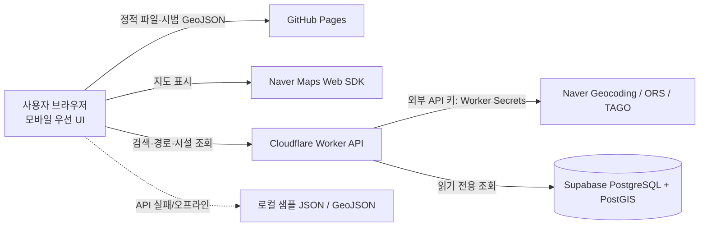

# 턱없이 기술 요구사항 정의서 (TRD)

- 기준 문서: `턱없이_해커톤_PRD_최종본`
- 문서 목적: 해커톤 시제품의 기술 선택, 데이터 경계, 구현 순서를 명확히 한다.
- 설계 원칙: 마산 시범 구역에 집중하고, 외부 연동 실패에도 시연이 가능해야 하며, 미검증 정보를 안전한 경로로 오인시키지 않는다.

## 1. 시스템 아키텍처

### 1.1 권장 기술 스택

| 영역 | 권장 기술 | 선택 이유 및 제약 |
|---|---|---|
| 웹 클라이언트 | HTML, CSS, Vanilla JavaScript ES modules | 현재 시안이 단일 `index.html`이며, 별도 프레임워크나 빌드 단계 없이 가장 빠르게 기능을 분리할 수 있다. |
| 정적 호스팅 | GitHub Pages + 현재 GitHub Actions 배포 | 저장소에 이미 배포 workflow가 있다. 정적 프런트엔드와 샘플 데이터는 무료로 바로 배포한다. Pages 게시 사이트는 최대 1 GB, 월 100 GB 대역폭은 권장 한도(soft limit)다. |
| API / 비밀키 보호 | Cloudflare Workers Free | Naver·OpenRouteService·공공 API의 비밀 키를 브라우저에 넣지 않고, 외부 API 응답을 정규화·캐시하는 작은 서버리스 API로 사용한다. 무료 플랜 한도는 현재 문서 기준 요청 100,000회/일이며 변경될 수 있다. |
| 데이터베이스 | Supabase PostgreSQL Free + PostGIS | 장애물 선분·충전소·정류장처럼 위치와 관계가 있는 데이터를 SQL로 관리하고, PostGIS로 공간 조회를 확장할 수 있다. 무료 DB 용량은 프로젝트당 500 MB이며, 1주 비활성 프로젝트는 일시 중지될 수 있으므로 시연/초기 검증용으로 한정한다. |
| 지도 / 경로 | Naver Maps Web Dynamic Map, OpenRouteService, OSM | PRD의 정보 제공처를 따른다. 실시간·커버리지·호출량은 제공자 조건에 종속되며, 접근성 속성은 별도 현장 검증 데이터와 함께 판단한다. |
| 버스 | 국토교통부 TAGO 및 창원시 버스정보 | 실시간 연동은 별도 단계로 두고, 연동 전에는 시범 데이터임을 표시한다. |

**비용·가용성 전제:** 현재 저장소의 GitHub Pages는 정적 시안 배포에 가장 빠른 선택이다. 실제 API 키가 필요한 기능을 추가할 때만 Worker를 붙이고, 공간 데이터가 수작업 샘플을 넘어설 때 Supabase를 연결한다. 무료 플랜은 SLA나 긴급 이동 안전을 보장하지 않는다. 서비스가 실제 이동의 유일한 안전 판단 수단이 되지 않도록 한다.

### 1.2 구성도 및 요청 흐름



1. 사용자가 위치 사용을 허용하거나 마산 내 장소를 검색해 출발지·도착지를 입력한다. 브라우저는 경로 요청에 필요한 최소 좌표와 기기 유형만 Worker에 보낸다.
2. Worker는 외부 경로·장소 API를 호출하고, DB의 검증된 접근성 구간과 대조해 쉬운 길·빠른 길 후보를 정규화한다.
3. 클라이언트는 `live`, `curated`, `sample`, `unknown`과 마지막 갱신 시각을 함께 표시한다. API 실패 시 로컬 샘플로 전환하되 샘플 데이터임을 화면에 명시한다.
4. 배터리 계산은 브라우저에서 수행한다. 방전 도움 화면은 사용자가 확인 후 전화·문자 앱을 여는 시연 흐름만 제공하며 자동 발송하지 않는다.

### 1.3 경로 판정 및 오류 처리

- PRD 시제품 기준을 정책 설정으로 분리한다: 유효 보도폭 1.2 m 미만, 장애물 간격 0.8 m 미만, 단차 2 cm 초과, 계단, 경사 1/12(약 4.8°) 이상. 이는 초기 분류 기준이지 모든 이동기기의 법적·기술적 통과 보증이 아니다.
- 현장에서 확인된 진입 불가 구간은 후보 경로에서 제외하고 빨간색·사유와 함께 표시한다. 기준값에 걸리지만 기기별 통과 여부가 검증되지 않은 구간은 주황색 주의로 표시한다. 정보가 없는 구간은 회색 `미확인`으로 남기며 초록색 안전 경로로 단정하지 않는다.
- 우회 경로가 없거나 경로와 접근성 자료를 신뢰성 있게 대조할 수 없으면 “경로 확인 불가”를 반환한다. 출처 API가 반환한 경로만으로 안전을 보증하지 않는다.
- 외부 API 오류, 타임아웃, 빈 응답은 출처별 오류로 기록하고 샘플 데이터로 전환한다. 샘플 데이터도 없으면 오류 상태를 사용자에게 알리며 빈 성공 응답으로 처리하지 않는다.
- 지도 렌더링용 Naver 클라이언트 키는 허용 도메인 제한을 설정한다. 외부 API 비밀 키는 Worker 환경의 Secret으로만 저장하며 GitHub 저장소·브라우저 번들·로그에 기록하지 않는다.

### 1.4 API 경계

Worker API는 공급자별 응답을 서비스 내부 형식으로 정규화한다.

| 메서드 / 경로 | 목적 | 주요 입력·출력 |
|---|---|---|
| `GET /api/v1/places/search?q=` | 마산 장소 검색 | 검색어, 장소 이름·좌표·출처 |
| `POST /api/v1/routes/compare` | 쉬운 길·빠른 길 비교 | 출발지·도착지 좌표, 기기 유형; 경로 선형, 거리·시간, 접근성 구간, 데이터 상태 |
| `GET /api/v1/chargers?bbox=` | 충전소 조회 | 지도 범위; 위치·운영 정보·출처·갱신 시각 |
| `GET /api/v1/bus/stops?near=` | 정류장·저상버스 정보 조회 | 기준 좌표; 정류장·운행 정보·실시간/샘플 상태 |

요청 좌표는 마산 시범 구역 범위를 우선 검증한다. Provider 응답의 공급자 전용 필드가 UI에 전파되지 않도록 변환 계층을 둔다. 실제 TAGO 도착정보·저상버스 유형 연동은 API 키와 데이터 제공 범위를 확인한 뒤 활성화한다.

## 2. 데이터 저장 구조

### 2.1 저장소별 책임

| 저장 위치 | 저장 대상 | 저장하지 않을 대상 |
|---|---|---|
| Git 저장소의 `public/data/demo/` | 검토된 시범 경로, 현장 확인 접근성 구간, 충전소·정류장 샘플. API 장애 시 읽기 전용 폴백으로 사용 | 비밀 키, 실제 사용자 위치 이력, 식별 가능한 사용자 정보 |
| Supabase PostgreSQL/PostGIS | 출처·갱신 시각이 있는 공개·검토 데이터. 초기에는 선택 사항이며 샘플 데이터로 우선 구현 | 개인 프로필, 검색·경로 기록, 배터리 상태 이력, SOS 요청 이력 |
| 브라우저 메모리 | 현재 화면의 출발지·도착지, 사용자가 입력한 배터리 잔량, 현재 세션 결과 | 서버 전송 후 장기 저장 또는 사용자 동의 없는 위치 저장 |
| Cloudflare Worker Secrets | Naver·ORS·TAGO 등 서버 API 비밀 키 | 공개 프런트엔드 설정 파일에 포함되는 비밀 값 |

### 2.2 관계형 공간 데이터 모델

모든 위치는 WGS 84 (`SRID=4326`)를 사용한다. DB 도입 시 PostGIS를 활성화하고, 공개 데이터는 `published = true`인 레코드만 읽을 수 있게 한다.

| 테이블 | 주요 컬럼 | 비고 |
|---|---|---|
| `access_segments` | `id UUID PK`, `geom LINESTRING(4326)`, `status ENUM(blocked,caution,pass,unknown)`, `clear_width_m NUMERIC NULL`, `obstacle_gap_m NUMERIC NULL`, `curb_height_cm NUMERIC NULL`, `slope_ratio NUMERIC NULL`, `has_stairs BOOLEAN`, `device_scope TEXT[]`, `source_id UUID FK`, `observed_at TIMESTAMPTZ`, `expires_at TIMESTAMPTZ NULL`, `published BOOLEAN` | 현장·공공·OSM 자료를 구분하고 측정값이 없으면 `NULL`로 유지한다. `geom`에는 GiST 인덱스를 둔다. |
| `charging_stations` | `id UUID PK`, `name TEXT`, `geom POINT(4326)`, `address TEXT`, `opening_hours TEXT NULL`, `phone TEXT NULL`, `is_active BOOLEAN`, `source_id UUID FK`, `updated_at TIMESTAMPTZ`, `published BOOLEAN` | 운영시간·연락처는 최신성을 보장할 수 없으면 미확인으로 표시한다. |
| `bus_stops` | `id TEXT PK`, `name TEXT`, `geom POINT(4326)`, `address TEXT NULL`, `source_id UUID FK`, `updated_at TIMESTAMPTZ`, `published BOOLEAN` | 정류장 기본 정보와 실시간 도착 정보의 갱신 시각을 분리한다. |
| `data_sources` | `id UUID PK`, `name TEXT`, `uri TEXT`, `license TEXT NULL`, `retrieved_at TIMESTAMPTZ`, `notes TEXT NULL` | 출처·라이선스·수집 시점을 각 시설/구간 데이터와 연결한다. |

**인덱스·무결성:** 공간 컬럼에 GiST, 외부 출처 ID가 있으면 해당 컬럼에 일반 인덱스를 둔다. `status`는 허용 값만 저장하고, 거리·폭·단차는 음수가 될 수 없도록 제약한다. `observed_at` 또는 `updated_at`이 오래된 데이터는 UI에서 갱신 필요/미확인으로 표시한다.

### 2.3 접근 제어, 개인정보, 샘플 폴백

- MVP는 로그인 없이 읽기 전용으로 운영한다. Supabase RLS를 활성화하고 익명 역할에는 게시된 공개 데이터의 `SELECT`만 허용한다. 익명 `INSERT/UPDATE/DELETE`는 금지한다. 데이터 적재·수정은 팀의 신뢰된 수동 배포 절차로 한다.
- 브라우저 좌표는 사용자가 위치 기능을 명시적으로 허용했을 때 현재 요청에만 사용한다. 목적지·현재 위치를 계정이나 DB에 저장하지 않는다. 위치 거부 시 장소 검색과 출발지 직접 입력을 제공한다.
- 배터리 잔량·완충 주행거리·환경계수 입력은 시연 계산에만 사용하고 서버에 보내지 않는다. PRD 계산식 `완충 주행거리 × (잔량 / 100) × 환경계수 × 0.85`와 계수(평지 1.0, 경사 포함 0.8)는 검증되지 않은 가정임을 표시한다.
- 정적 폴백은 `public/data/demo/`에 JSON/GeoJSON으로 버전 관리한다. 각 객체에 `data_status: "sample"`과 `updated_at`을 두고, 폴백 응답도 실시간 데이터처럼 표시하지 않는다.
- 사용자 리뷰 저장·자동 학습, 실시간 BMS 연동, 자동 문자·신고, 전국 경로 엔진은 이번 범위에서 제외한다.

## 3. 파일 구조 및 구현 계획

### 3.1 목표 파일 구조

현재 저장소는 `index.html` 중심 시안과 `.github/workflows/pages.yml` 배포 구성이다. 초기 구현에서는 프레임워크·빌드 단계를 새로 추가하지 않고 ES modules로 점진 분리한다.

```text
.
├── index.html
├── README.md
├── public/
│   ├── manifest.webmanifest
│   ├── icons/
│   └── data/
│       └── demo/
│           ├── routes.geojson
│           ├── access-segments.geojson
│           ├── charging-stations.json
│           └── bus-stops.json
├── src/
│   ├── main.js
│   ├── app/
│   │   ├── state.js
│   │   └── accessibility.js
│   ├── features/
│   │   ├── routes/       # 장소 입력, 경로 비교·표시
│   │   ├── bus/          # 정류장·저상버스 정보
│   │   ├── battery/      # 순수 계산 로직·입력 검증
│   │   └── help/         # 위치 확인·전화/문자 시연
│   ├── services/
│   │   ├── api-client.js
│   │   ├── fallback-data.js
│   │   └── map.js
│   └── styles/
│       └── app.css
├── worker/
│   └── src/
│       ├── index.js
│       └── providers/    # Naver, ORS, TAGO 어댑터
├── supabase/
│   └── migrations/
│       └── 001_initial_schema.sql
├── tests/
│   ├── access-policy.test.js
│   └── battery.test.js
└── .github/
    └── workflows/
        └── pages.yml
```

`worker/`와 `supabase/`는 실제 API·DB 연동을 시작할 때 추가한다. 지도 SDK의 브라우저용 공개 키 외에 서버 비밀 키를 `index.html`, `src/`, `public/` 파일에 하드코딩하지 않는다. 샘플 JSON은 출처와 시연 데이터 여부를 함께 관리한다.

### 3.2 구현 단계 및 완료 기준

1. **시안 기반 정리:** 현재 단일 HTML의 경로·버스·배터리·도움 화면을 ES modules와 기능별 스타일로 분리한다. 기존 GitHub Actions / Pages 배포를 유지하고 모바일·키보드·고대비·큰 글씨 동작을 확인한다.
2. **P1 경로 찾기:** Naver 지도 표시와 마산 장소 검색, 출발·도착지 입력, 이동기기 선택, 쉬운 길·빠른 길 비교를 구현한다. 2~3개 시범 경로의 검증된 장애물·우회 구간을 표시하고, 실패 시 샘플 폴백 및 데이터 상태 라벨을 노출한다. 실제 연동 경로와 샘플 경로를 UI에서 구분한다.
3. **접근성 데이터와 API 계층:** 외부 API 키가 필요한 시점에 Cloudflare Worker를 추가하고 공급자 어댑터·타임아웃·오류 응답을 구현한다. 검증된 진입 불가 구간을 경로에서 회피할 수 없는 경우 추천 완료로 표시하지 않는다. Supabase/PostGIS는 팀이 수작업 JSON 유지보다 DB 관리가 필요한 시점에 추가한다.
4. **이동시간·버스:** 도보/휠체어/자동차 거리·시간을 비교하고 TAGO/창원시 버스정보 연결 여부를 상태와 함께 표기한다. 실시간 API 미연동이면 고정 샘플을 사용하고 실제 도착 정보로 오인하지 않게 한다.
5. **P2/P3 배터리·도움 화면:** 잔량·완충 주행거리·환경 조건 입력, 계산식과 가정의 고지, 충전소 목록·경유 안내를 구현한다. SOS는 위치 확인 및 사용자가 직접 누르는 전화·문자 연결만 제공하며 자동 발송하지 않는다.
6. **검증:** PRD의 시범 과업으로 경로 찾기 완료율 80% 이상, 평균 완료시간 30초 이내를 측정한다. 시범 구간에 등록한 진입 불가 구간의 빨간 표시·회피 인지율은 100%를 목표로 한다. 배터리 계산은 수기 결과와 비교하고, API 실패·폴백 전환·정보 오해를 기록한다.

### 3.3 주요 테스트 항목

- 접근성 정책 경계값: 폭 1.2 m, 간격 0.8 m, 단차 2 cm, 경사 1/12의 미만/초과 및 미확인 값 처리.
- 경로 결과: 검증된 진입 불가 구간 제외, 미확인 구간의 회색 표시, 우회 불가 시 “경로 확인 불가” 표시.
- API 실패: 타임아웃·쿼터 초과·빈 응답 때 샘플 데이터로 전환하고 샘플임을 항상 표시.
- 배터리: 잔량 0·100%, 잘못된 음수/범위 초과 입력, 평지/경사 계수 결과를 수기 계산과 비교.
- 개인정보·시연: 위치 권한 거부 시 수동 입력 가능, 위치·배터리·SOS 정보를 서버에 저장하지 않음, 전화/문자 자동 발송이 발생하지 않음.
- 접근성 UI: 색상만으로 위험도를 구분하지 않고 텍스트·아이콘을 함께 제공하며 키보드 조작, 고대비, 큰 글씨를 확인.

## 참고 문서

- PRD: `턱없이_해커톤_PRD_최종본`
- GitHub Pages limits: https://docs.github.com/pages/getting-started-with-github-pages/github-pages-limits
- Cloudflare Workers pricing: https://developers.cloudflare.com/workers/platform/pricing/
- Supabase pricing: https://supabase.com/pricing
